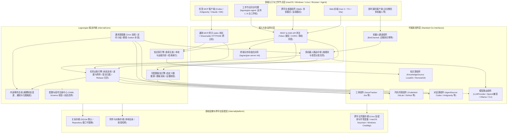
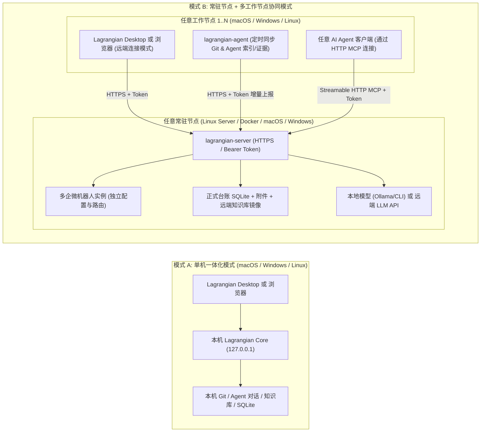
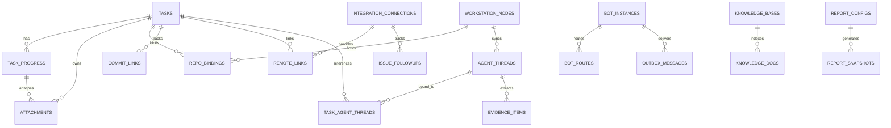

# Lagrangian 架构图与总体设计方案

> **项目定位**：面向个人开发者的通用工程工作台（Go + Vue 3 + TypeScript + Wails），与特定公司、项目、硬件设备和操作系统彻底解耦。支持源码构建与 Linux / macOS / Windows 多平台发行包分发，零个人数据预置，首次启动通过引导流程完成配置。

---

## 1. 设计目标与反黑盒原则

1. **架构先于代码，文档随阶段同步**：每个阶段交付时必须同步更新对应模块的数据流图与代码导读文档，确保任意功能都能从入口追踪到存储，不出现无法理解的黑盒。
2. **零硬编码与零个人数据**：仓库中不包含任何用户名、提交作者别名、公司域名、固定端口、固定工单中文状态、固定机器人名称或固定知识库路径；所有运行参数由统一配置文件与首次安装引导生成。
3. **内核稳定，能力组件化**：任务台账、事件总线、调度器、存储与鉴权属于稳定内核；GitLab/Jira、企微机器人、Agent 对话同步、知识库源、LLM、凭据库均以标准 Go Interface 接入，通过配置启停与实例化。
4. **设备无关与双模式同构**：不将工作节点绑定为特定笔记本，也不将常驻节点绑定为特定主机。同一套 Go 服务端、同步代理与桌面轻壳，支持在 **Linux / macOS / Windows** 任意组合下以“单机模式”或“常驻节点 + 多工作节点”模式运行。

---

## 2. 总体系统架构图



---

## 3. 设备无关的双模式部署拓扑

无论采用**单机模式**还是**常驻节点 + 多工作节点模式**，均不限定具体硬件形态，使用同一套构建产物、仅通过配置切换：

| 节点角色 | 支持操作系统与运行形态 | 典型载体（不限定） |
|---|---|---|
| **常驻节点（Always-on Server Node）** | **Linux**（`amd64` / `arm64`，原生单二进制 + `systemd` / Docker）、**macOS**（`launchd`）、**Windows**（Windows Service） | Linux 云服务器 / VPS、内网 Linux 主机、NAS / Docker、macOS / Windows 常驻主机 |
| **工作节点（Workstation / Client Node）** | **macOS**、**Windows**、**Linux**（支持同时接入 1 到多台工作节点） | 个人笔记本、台式机、远程开发机 |



---

## 4. 九大功能域的组件化与可配置设计

所有组件通过 `ConfigMgr` 统一加载，每个组件均可按需开启/关闭，并支持同类型配置多个实例。

| 功能域 | 抽象组件接口 | 首批内置适配器 | 关键可配置项（消除硬编码） |
|---|---|---|---|
| **1. 核心任务台账 & Web** | 内核模块（非外挂） | 内置 | 自定义任务状态流（默认提供通用状态集，支持映射与自定义）、监听地址与端口、数据与附件目录 |
| **2. GitLab / Jira 集成** | `CodeHost` / `IssueTracker` | `gitlab`、`jira` | 多实例连接、认证方式（Token/Basic）、作者别名列表、可配置巡检状态白名单 |
| **3. 多企微机器人** | `BotChannel` + `BotRouter` | `wecom`（支持多实例） | 机器人名称、凭据引用、职责标签（巡检 / 任务录入 / 晚间汇报等）、定时 Cron 表达式、路由过滤规则 |
| **4. 多 Agent 对话同步** | `AgentSource` | `codex`、`antigravity` | 运行模式（`local_direct` 本机直读 / `remote_push` 工作节点代理上报）、跨平台数据目录（Windows / macOS / Linux）、多工作节点来源标识、隐私脱敏规则（仅传索引/摘要，原文留工作节点） |
| **5. 通用跨主机 MCP** | `MCPServer` | `stdio`、`http_sse` | 监听地址、启停开关、只读/读写工具白名单、客户端独立 API Token、支持任意兼容 MCP 的 Agent |
| **6. 可配置报告引擎** | `ReportSource` + `Template` | 任务进展、Git 提交、MR、工单、Agent 证据 | 报告周期、自由组合数据源、自定义 Markdown 模板、绑定的 LLM Profile、事实核验开关 |
| **7. 通用知识库管理** | `KnowledgeSource` | `local_dir`、`remote_git` | 自定义任意数量知识库（名称、本地路径或远端 Git URL + 分支 + 凭据引用、同步周期、只读/可编辑模式、可选校验脚本） |
| **8. 跨平台桌面端** | Wails 轻壳 | macOS `.app/.dmg`、Windows `.exe/.msi`（可选 Linux） | 多服务端连接 Profile（一键切换本机嵌入式 Core 或任意远端常驻节点）、开机自启、系统托盘行为 |
| **9. 统一多 LLM 路由** | `LLMProvider` | `openai_compat`、`ollama`、`cli_command` | 多模型 Profile（Base URL、Model、凭据引用、超时、工具调用能力）、按场景路由表（报告 / 机器人 / 晚间总结 / 知识问答） |

---

## 5. 前端设计构想：Lagrangian 轨道可视化 + 实用工程视图

1. **轨道总览视图（Lagrangian Orbit View）**：
   - 以核心工作台为引力中心，三层同心轨道与 `L1–L5` 拉格朗日参考点呈现协同运转状态：
     - **内轨（L1–L2）**：进行中任务、阻塞项与即将到期工单；
     - **中轨（L3）**：关联仓库分支、待合并 MR 与自动归属的新提交；
     - **外轨（L4–L5）**：接入的工作节点同步代理（Linux / macOS / Windows）、多机器人心跳、Agent 对话流与知识库同步状态。
   - 点击任意节点展开右侧透视面板并快速跳转。
2. **高效工程台账视图（Workbench Table / Detail View）**：
   - 高信息密度任务列表、分栏详情、进展与附件预览、分支与提交管理、配置与组件中心。
3. **独立前端工程（Vue 3 + TypeScript + Vite）**：
   - 严格类型定义与 Go DTO 对齐，开发期代理联调、发布期通过 `go:embed` 打入单个服务端二进制。

---

## 6. 核心数据模型（ER 关系与表规划）

采用纯 Go SQLite（`modernc.org/sqlite`，零 CGO）+ WAL 模式 + 版本化 SQL 迁移脚本：



- **Phase 1（`001_init.sql`）**：`workstation_nodes`、`tasks`、`task_progress`、`attachments`、`repo_bindings`、`commit_links`（含 `patch_id` 与 `superseded_by` Rebase 替代链）。
- **Phase 2（`002_integrations_kb.sql`）**：`integration_connections`、`remote_links`、`issue_followups`、`knowledge_bases`、`knowledge_docs`、`knowledge_fts`（FTS5）。
- **Phase 3（`003_agents_sync.sql`）**：`agent_threads`、`task_agent_threads`、`evidence_items`。
- **Phase 4（`004_bots_reports.sql`）**：`bot_instances`、`bot_routes`、`outbox_messages`、`report_configs`、`report_snapshots`。

---

## 7. 仓库目录结构

```text
Lagrangian/
├── README.md                       # 快速启动、跨平台部署与配置手册
├── DESIGN.md                       # 本架构图与总体设计方案
├── Makefile                        # 构建、测试、前后端联调、Linux/macOS/Windows 交叉编译
├── go.mod
├── configs/
│   └── config.example.yaml         # 全量注释的配置模板（零个人数据）
├── cmd/
│   ├── lagrangian-server/          # 常驻/单机核心服务端（单二进制内嵌前端）
│   ├── lagrangian-agent/           # 跨平台工作节点同步代理（Phase 3）
│   ├── lagrangian-mcp/             # 本地 stdio MCP 桥接（Phase 3）
│   └── lagrangian-desktop/         # Wails 跨平台桌面轻壳（Phase 5）
├── internal/
│   ├── config/                     # YAML 配置加载、校验、默认值与保存
│   ├── domain/                     # 纯领域模型
│   ├── core/                       # 核心业务编排、Git 扫描与 Rebase 归并
│   ├── storage/                    # 纯 Go SQLite 持久化、内嵌 SQL 迁移、附件存储
│   ├── components/                 # 可插拔组件标准 Go Interface 契约与注册表
│   ├── transport/                  # HTTP API + SPA 托管（Phase 1）、MCP 网关（Phase 3）
│   └── platform/                   # 跨平台路径与凭据抽象（Linux / macOS / Windows）
├── frontend/                       # 独立 Vue 3 + TypeScript + Vite 前端工程
├── packaging/
│   ├── linux/                      # systemd service 单元模板与 Dockerfile
│   ├── macos/                      # launchd 与 .app/.dmg 打包（Phase 5）
│   └── windows/                    # Windows 服务与 .exe/.msi 打包（Phase 5）
└── docs/
    ├── architecture.md             # 分层依赖与组件扩展开发指南
    └── walkthroughs/               # 分阶段逐文件代码导读（Phase 1..5）
```

---

## 8. 分阶段迭代路线图

| 阶段 | 交付范围 | 核心验收标准 |
|---|---|---|
| **Phase 1** | 工程骨架、Linux/macOS/Windows 路径与凭据抽象、Setup Wizard、组件注册中心、核心任务台账（进展/附件/多分支/提交/Rebase 归并）、Vue 3 轨道总览与台账界面、Linux `systemd`/Dockerfile 模板与代码导读 | 空白目录一键启动，零个人数据；Linux `amd64`/`arm64`、macOS、Windows 交叉编译全通过；Go `-race` 测试与前端类型检查通过 |
| **Phase 2** | GitLab / Jira 可插拔组件（工单搁置/验收、远端提交筛选）、通用多知识库（本地目录 + 远端 Git 同步 + FTS5 全文检索） | 不改代码仅通过配置接入任意实例与多知识库，凭据不落明文 |
| **Phase 3** | 跨平台工作节点代理 `lagrangian-agent`（macOS / Windows / Linux 多节点同步 Git 与 Codex/Antigravity 对话）、通用跨主机 MCP 网关（`stdio` + `Streamable HTTP/SSE`） | 单机直读与跨机多工作节点上报均通过实测；外部 Agent 跨主机通过 MCP 读写台账与知识库 |
| **Phase 4** | 统一多 LLM 路由（OpenAI 兼容 / Ollama / CLI）、可配置数据源与模板的报告引擎、多企微机器人实例与职责路由 + Outbox 断线补发 | 多机器人按配置互不干扰；Linux 无头常驻节点稳定运行；模型与报告数据源可热切换 |
| **Phase 5** | Wails 跨平台桌面轻壳（本机模式 / 远端常驻节点模式自由切换）与 Linux / macOS / Windows 全平台发行包体系 | 无 Go/Node 环境的全新主机可直接安装运行，单机与远端模式全部可用 |
